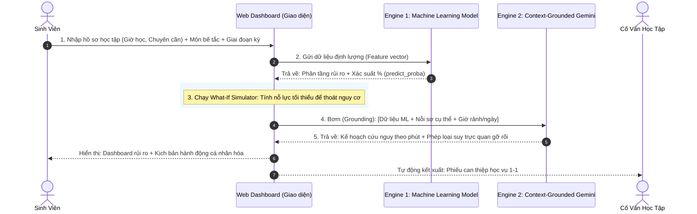

Dưới đây là **Bản Đặc Tả Toàn Bộ Quy Trình Từ Đầu Đến Cuối (End-to-End Workflow)** và **Chi Tiết Các Chức Năng Cải Tiến Đã Được Tinh Chỉnh Hoàn Hảo**, kèm theo **Bản Rà Soát Lỗ Hổng Kỹ Thuật & Nghiệp Vụ** để bạn kiểm tra thật kỹ trước khi triển khai.

---

# 📑 TỔNG QUAN HỆ THỐNG: EduPredict AI (HaUI Edition)
* **Bản chất:** *Hệ thống Cảnh báo Sớm Nguy cơ Học tập & Điều phối Can thiệp Cá nhân hóa dựa trên sự kết hợp giữa **Machine Learning Định lượng** và **Generative AI Định tính (Context-Grounded Gemini)**.*
* **Hai đối tượng sử dụng:**
  1. **Sinh viên:** Tự chẩn đoán thói quen, nhìn thấy rủi ro và nhận kịch bản hành động cứu nguy theo quỹ thời gian thực tế.
  2. **Cố vấn học tập (CVHT) / Khoa:** Nhận phiếu tổng hợp rủi ro để can thiệp kịp thời trước kỳ thi.

---

# 🔄 I. QUY TRÌNH VẬN HÀNH TOÀN BỘ TỪ ĐẦU ĐẾN CUỐI (4 BƯỚC)

---

# ⚙️ II. CHI TIẾT CÁC CHỨC NĂNG CẢI TIẾN (ĐÃ XỬ LÝ HẾT CÁC BẤT CẬP)

### 📌 Chức năng 1: Khối Nhập Liệu Tinh Gọn (Zero-Friction Input)
* **Không bắt sinh viên nhập điểm thi ảo, không bắt upload tài liệu.**
* Gồm 3 phần thông tin nhập chỉ mất 45 giây:
  1. **Thói quen thực tế (Hành vi):**
     * Số giờ tự học mỗi tuần (Slider: 0 - 16h).
     * Tỷ lệ chuyên cần đến lớp (Slider: 0 - 100%).
     * Có tham gia học nhóm/học kèm hay không (Yes/No).
     * Thông tin nhân khẩu học cơ bản (Giới tính, Khu vực).
  2. **Giai đoạn học kỳ hiện tại (Dropdown linh hoạt):**
     * *Đầu kỳ (Tuần 1 - 4):* Giai đoạn xây dựng nền tảng.
     * *Giữa kỳ (Tuần 5 - 9):* Giai đoạn bài kiểm tra điều kiện & bài tập lớn.
     * *Nước rút cuối kỳ (Tuần 10+):* Giai đoạn chuẩn bị thi hết môn.
  3. **Nút thắt cụ thể (1 ô Textarea tự do):**
     * Sinh viên gõ môn đang lo lắng nhất và chỗ đang bị tắc. *(Ví dụ: "Kỹ thuật lập trình: Em không hiểu con trỏ và mảng cấp phát động")*.

---

### 📌 Chức năng 2: Động Cơ Phân Tầng Rủi Ro (Machine Learning Engine)
* **Xử lý:** Mô hình `Logistic Regression (Class-Weighted)` đã huấn luyện trên tập 4.000 sinh viên.
* **Đầu ra khoa học:**
  * **Phân tầng 3 cấp độ:**
    * 🔴 **Nguy Cơ Cao (Báo động Đỏ):** Nguy cơ rớt môn / học lại rất lớn nếu giữ nguyên nhịp độ.
    * 🟡 **Đạt Chuẩn (Vùng An Toàn):** Đủ điều kiện qua môn ổn định.
    * 🟢 **Năng Lực Cao (Tiềm Năng Khá/Giỏi):** Khả năng đạt học bổng hoặc điểm A/B+.
  * **Chỉ số xác suất thực tế (predict_proba):** Ví dụ: `Nguy cơ: 86.9% | Đạt chuẩn: 13.1% | Xuất sắc: 0.0%`.
  * **Bóc tách nguyên nhân rủi ro:** Chỉ rõ rủi ro chủ yếu do **Vắng học quá nhiều (Chuyên cần 64.3%)** hay do **Quỹ giờ tự học quá ít (3.7h)**.

---

### 📌 Chức năng 3: Bộ Mô Phỏng "Lật Ngược Thế Cờ" (What-If Simulator)
* **Vấn đề giải quyết:** Sinh viên thấy 86.9% nguy cơ thì sẽ hoang mang, cần biết phải làm gì tối thiểu để thoát hiểm.
* **Cơ chế hoạt động:**
  * Khi rơi vào Nhóm Đỏ, hệ thống tự động chạy thuật toán quét ngược:
  * Đưa ra khuyến nghị định lượng chính xác:
    > *"Để kéo xác suất nguy cơ từ **86.9% $\rightarrow$ dưới 25% (Về Vùng An Toàn)**, bạn cần đạt **Ngưỡng Tối Thiểu** sau:
    > • Tuyệt đối không nghỉ thêm buổi nào để giữ chuyên cần $\ge 75\%$.
    > • Tăng thời gian tự học từ **3.7h $\rightarrow$ 6.0h/tuần** (thêm đúng 20 phút mỗi ngày)."*
* **Thanh kéo tương tác (Interactive Target Slider):** Sinh viên có thể tự kéo thanh giờ học để nhìn thấy thanh xác suất nguy cơ lập tức tụt xuống theo thời gian thực (Real-time).

---

### 📌 Chức năng 4: "Bác Sĩ Gỡ Rối Học Thuật" (Context-Grounded Gemini)
* **Khác biệt cốt lõi với Gemini bên ngoài:** 
  Hệ thống âm thầm đóng gói toàn bộ con số của sinh viên vào System Prompt:
  `[Bối cảnh: Sinh viên HaUI, chuyên cần 64%, giờ học chỉ có 3.7h/tuần (~30 phút/ngày), nguy cơ rớt 86.9%, giai đoạn Giữa kỳ, đang tắc môn Kỹ thuật lập trình ở phần con trỏ]`.
* **Gemini xuất ra Card giải pháp độc quyền gồm 2 phần:**
  1. **"Thông Não Trong 3 Phút" (Intuitive Analogy):** 
     Dùng hình ảnh đời thường giải thích bản chất khái niệm đang bị tắc (ví dụ: ví con trỏ như chìa khóa tủ đồ siêu thị) thay vì đọc lại định nghĩa sách giáo khoa.
  2. **"Kịch Bản Hành Động 30 Phút Hôm Nay" (Micro-Sprint):**
     Khớp đúng với 30 phút rảnh của sinh viên:
     * 10 phút đầu làm gì (vẽ sơ đồ tay).
     * 15 phút tiếp theo làm gì (chạy thử 1 đoạn code mẫu).
     * 5 phút cuối làm gì (tự kiểm tra lại).

---

### 📌 Chức năng 5: Trục Tương Tác Cố Vấn Học Tập (CVHT Dashboard)
* Thay vì tab phụ huynh vô nghĩa, hệ thống có **Tab Cố Vấn Học Tập**:
  * Tự động sinh **"Phiếu Ghi Chú Can Thiệp Học Vụ"**:
    * Thông tin tóm tắt: Tỷ lệ vắng, số giờ học, môn học đang bế tắc.
    * Mức độ can thiệp: *Khẩn cấp (nguy cơ cấm thi do chuyên cần < 80%)*.
    * Hành động đề xuất cho thầy cô: Xếp lịch gặp 1-1, đưa sinh viên vào nhóm có bạn khá kèm cặp.
  * Có nút **`[📋 Sao chép phiếu ghi chú]`** để giảng viên lưu vào sổ tay theo dõi lớp.

---

# 🔍 III. BẢN RÀ SOÁT LỖ HỔNG (VULNERABILITY AUDIT)

| Điểm kiểm tra | Rủi ro có thể bị BGK hỏi | Cách hệ thống xử lý (Không kẽ hở) |
| :--- | :--- | :--- |
| **1. Tính phụ thuộc Gemini** | *"Nếu mạng mất hoặc hết hạn ngạch (quota) API Gemini thì web có chết không?"* | **Đã có fallback:** Nếu Gemini lỗi, hệ thống vẫn chạy 100% bình thường phần ML phân tầng rủi ro, xác suất và khuyến nghị chuẩn quy chế. Gemini chỉ là lớp giá trị gia tăng (Add-on). |
| **2. Tính chủ quan dữ liệu** | *"Sinh viên tự kéo slider chuyên cần 90% để ra kết quả đẹp thì sao?"* | Trả lời: Đây là công cụ **Tự chẩn đoán cứu mình (Diagnostic Tool)**, không phải phần mềm tính điểm thi đua. Sinh viên tự lừa mình thì không giải quyết được nguy cơ của họ. |
| **3. Giáo trình HaUI** | *"Gemini có biết giáo trình riêng của HaUI không?"* | Hệ thống **không đoán đề thi hay giáo trình**, mà giải thích **khái niệm cốt lõi theo tư duy bản chất** và **quản lý thời gian học tập**. Bản chất con trỏ hay tích phân ở trường nào cũng giống nhau. |
| **4. Thời điểm sử dụng** | *"Sinh viên vào dùng lúc nào trong kỳ?"* | Đã có dropdown chọn **Giai đoạn học kỳ** (Đầu kỳ / Giữa kỳ / Cuối kỳ) để lời khuyên thích ứng chuẩn xác, không bị cố định 14 ngày. |

---

# 🚀 BẠN THẤY BẢN ĐẶC TẢ NÀY NHƯ THẾ NÀO?
Toàn bộ logic từ: **Input $\rightarrow$ ML Phân Tầng $\rightarrow$ What-If Toán Học $\rightarrow$ Gemini Kê Đơn $\rightarrow$ Phiếu CVHT** đã tạo thành một **vòng tròn khép kín, thực tế 100%, không còn bất kỳ chi tiết ảo nào**.

Bạn xem còn chi tiết nào làm bạn băn khoăn nữa không? Nếu đã hoàn toàn thông suốt, chúng ta sẽ bắt đầu code ngay vào [web_classifier.py](file:///d:/sict_inovation/EduPredict-Classification/web_classifier.py)!